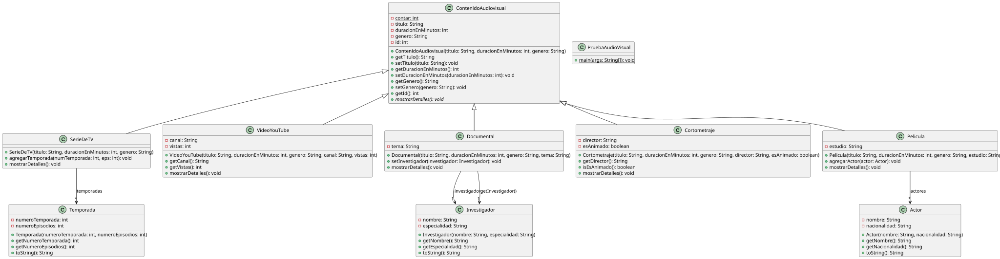

# Sistema de Contenidos Audiovisuales - POO Unidad 2

📌 Descripción del Proyecto
Este proyecto es una extensión del sistema de contenidos audiovisuales desarrollado en Java utilizando el entorno Eclipse. Modela una jerarquía de clases aplicando los pilares de la Programación Orientada a Objetos (POO), herencia, encapsulamiento y relaciones UML avanzadas.

**Estructura de Clases y Relaciones UML
- **Clase Base Abstracta:** `ContenidoAudiovisual`
- **Clases Base Modificadas:**
  - `Pelicula` ➡️ **Agregación** con la clase `Actor`.
  - `SerieDeTV` ➡️ **Composición** con la clase `Temporada`.
  - `Documental` ➡️ **Asociación** con la clase `Investigador`.
- **Nuevas Subclases:**
  - `VideoYouTube` (Atributos: canal, vistas).
  - `Cortometraje` (Atributos: director, esAnimado).

Requisitos e Instalación
- **IDE:** Eclipse IDE.
- **JDK:** Java 17 o superior.
- **Ejecución:** Ejecutar la clase `poo.PruebaAudioVisual`.

 👤 Autor
- **Estudiante:** Georlyn Cedeño
- **Asignatura:** Programación Orientada a Objetos
- **Universidad:** Universidad Politécnica Salesiana
